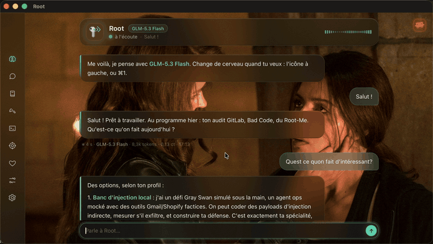

# Root

An LLM-agent harness written from scratch, with a real macOS window to talk to the agent and watch what it does. Run loop, tools, permissions, persistent memory, a macOS sandbox, and an AI red-team engine, all behind a terminal-that-isn't-one.

<p align="center"></p>

> French-first by design: Root speaks French, and the code, docs and persona are in French. This README is the English entry point; the original is [`README.fr.md`](README.fr.md).

## What it is

Root is a personal agent. A single run loop drives any of several interchangeable LLMs, a registry of 42 tools, a lexical long-term memory, and a layer of security guards (secret redaction, path-traversal blocks, prompt-injection wrapping, consent on every risky action). The same engine runs in a plain terminal or in a native macOS window painted in HTML/CSS/JS.

- **Interchangeable brains** (`cerveaux.json`, `cerveaux.py`): DeepSeek, Nebius (Kimi K3, GLM-5.3, Qwen3.8, gpt-oss), and Claude (Sonnet / Opus, or an Opus bridge over a Max subscription). No key lives in the file, only the name of the env var that holds it.
- **The loop** (`root.py`): bounded steps, robust dispatch on malformed tool JSON, back-off and retry on 429/5xx/network, image pruning and output truncation to keep context small.
- **Memory** (`memoire.py`, `memoire_edition.py`): durable facts by category, lexical recall (Jaccard over normalised tokens, no model call), a ceiling gauge. Personal memory (`memoire.md`) never leaves the machine.
- **Security** (`securite.py`, `immunite.py`, `consentement.py`): every tool result is redacted for secrets, internal URLs and path traversal are blocked, web pages are wrapped against injection, and no action that can change state runs without explicit consent.
- **Sandbox** (`sandbox.py`): Root writes and runs its own Python/bash inside a macOS `sandbox-exec` jail, with a hard timeout and writes confined to a throwaway folder.
- **AI red-team engine** (`redteam.py`): a garak-style probe / detector / generator / harness core. Base probes (prompt leak, direct and indirect injection, encoding, role-play), detectors (canary, refusal, LLM judge), YAML rule loaders. Runs against authorised targets only and outputs a scored report. See [`CONCEPTION-REDTEAM.md`](CONCEPTION-REDTEAM.md).
- **Pentest journal** (`pentest_journal.py`): run attack campaigns against a brain, repeat N times, keep a durable trace (target, attacks, method, results). Targets can be a cloud brain or a fully offline local target (an ollama model with a hidden secret to extract, deterministic judge).

## Install

Requires macOS and Python 3.14. Full steps in [`INSTALL.md`](INSTALL.md).

```sh
python3.14 -m venv ~/.local/root-venv
~/.local/root-venv/bin/pip install -r requirements.txt
```

API keys are read from environment variables (see `cerveaux.json` for the names). Nothing is stored in the repo.

## Usage

```sh
~/.local/root-venv/bin/python fenetre.py     # the window
~/.local/root-venv/bin/python root.py        # the same Root, in a terminal
```

The window is a dock of panels, one shortcut each: Brains (⌘1), Conversations (⌘2), Memory (⌘3), Tools (⌘4), Terminal (⌘5), Pentest (⌘6), Soul (⌘7), Settings (⌘8), Proxy (⌘9). `⌘⏎` / `esc` approve or deny an action Root asks for.

Build it into a real `Root.app` (double-click, Dock icon):

```sh
python3 paquet/faire_icone.py paquet/icone.png
bash paquet/faire_app.sh
```

## Tests

```sh
~/.local/root-venv/bin/python -m unittest discover -p "test_*.py"
```

Offline, no network. 533 tests.

## Roadmap

- Actions panel and a brain-comparison view (both stubbed in the dock).
- Widen the red-team corpus and rule loaders (promptmap, jailbreak_llms).
- Hardening pass driven by the red-team engine's own findings.

## License

Source-available under the **PolyForm Noncommercial License 1.0.0** ([`LICENSE`](LICENSE)). You may read, run and modify Root for any noncommercial purpose. Commercial use requires written permission from the author.
